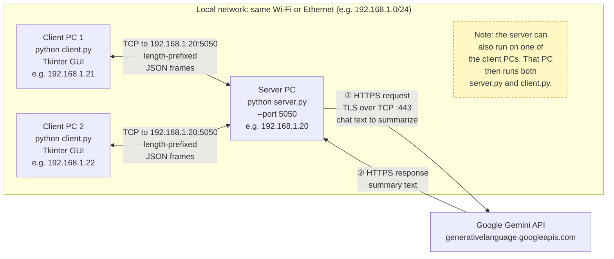
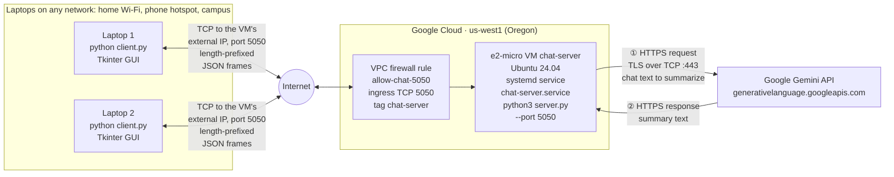
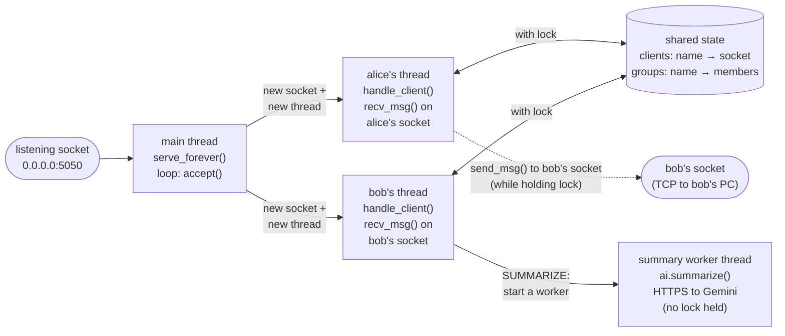
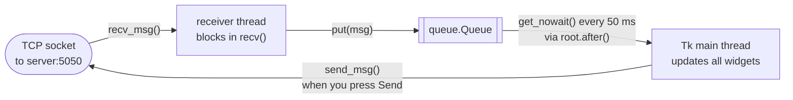
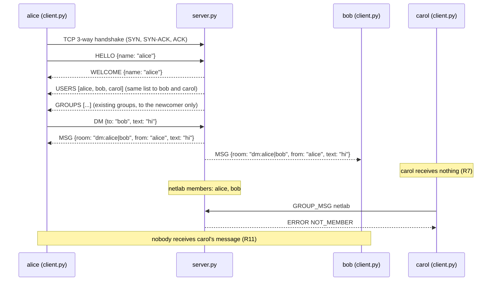
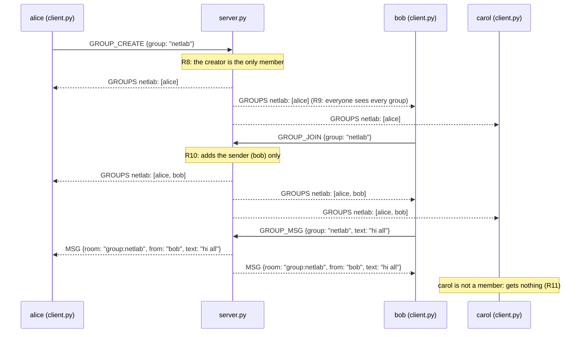

# System Architecture (R1)

Material for the two R1 slides: the architecture diagram, and which protocols we use, why, and how.
The PNG versions of the diagrams are in [`docs/diagrams/`](diagrams/), ready to paste into slides. They are rendered from the
Mermaid blocks below by `python scripts/render_diagrams.py`.

## 1. Deployment: who talks to whom

The chat runs on **at least three processes on at least two physical computers**: one `server.py`, and one `client.py`
per user. In the demo the server can run on a third PC or on one of the client PCs. Every client opens **one TCP
connection** to the server. Clients never connect to each other, so all chat traffic goes through the server, and the
server decides who receives what.

<!-- diagram: deployment -->


- The IP addresses are examples. On the day, read the server's address from `ipconfig` (see the README's demo section).
- The Gemini call (①, ②) happens only when someone presses **Summarize** (Special 1). The server makes it from a worker
  thread, so chat keeps flowing while Gemini answers.
- The server listens on `0.0.0.0:5050`, which means "port 5050 on every network interface of this PC".
- Only the **server** talks to Gemini, so the API key never leaves the server machine.

### Cloud variant: Google Cloud VM

The same programs, with the server on a free **e2-micro VM** in Google Cloud (us-west1, Oregon) instead of on a lab PC
(optional special point; setup in [`deploy/README.md`](../deploy/README.md)). The laptops can then be on **any** network.

<!-- diagram: deployment-cloud -->


- **Why it works from any network:** each laptop *opens* an outgoing TCP connection to the VM, which home routers, NAT
  and campus networks normally allow. Only the VM needs an open **inbound** port, and the firewall rule opens exactly
  one: TCP 5050, for VMs tagged `chat-server`.
- **Why a VM:** our protocol is raw TCP. The server is a long-running process that holds one open connection per client
  and listens on its own port. Static hosting only serves files, and serverless platforms only run code per HTTP request
  on their own HTTPS port, so neither can accept a raw TCP connection that stays open.
- `systemd` keeps `server.py` running after SSH is closed, restarts it if it crashes, and starts it when the VM boots.
- The Gemini call is the same HTTPS request as on a lab PC; it now goes from Google's network, and the key sits in `.env` on
  the VM only.
- Everything else (protocol, threads, privacy rules) is unchanged: the VM runs the same `server.py`.

## 2. Inside each program: threads

**Server (`server.py`):**

<!-- diagram: threads-server -->


**Client (`client.py`, one per user):**

<!-- diagram: threads-client -->


- **Server:** `accept()` returns a new socket for each client. Each socket gets its own thread, which blocks in `recv()` on
  that client only. All threads share the `clients` and `groups` dictionaries, so one `threading.Lock` protects them.
- **Any** server thread may write to a client's socket (the dashed arrow). When alice sends bob a DM, it's *alice's* thread that
  writes to *bob's* socket, while bob's own thread may be writing to it at the same moment. So sends also happen under the
  lock; otherwise two threads could interleave the bytes of two frames on one socket.
- **Summary worker (Special 1):** a `SUMMARIZE` request starts a short-lived worker thread that calls Gemini **without**
  holding the lock (it can take seconds), then takes the lock just to send the `SUMMARY` back to the requester.
- **Client:** Tkinter is not thread-safe, so only the main thread touches widgets. The receiver thread just
  blocks in `recv()` and puts messages on a queue, which the main thread drains with `root.after()`. The GUI never freezes
  while waiting for the network.

## 3. Conversations, message by message

**Login, a private message, and a rejected group message** (R3, R4, R7, R11):

<!-- diagram: sequence-dm -->


**Creating, joining and messaging a group** (R8–R11). All three users are already logged in:

<!-- diagram: sequence-groups -->


## 4. Protocols: what, why, how

We use five protocols, stacked like this. Each layer is carried inside the one below it:

| Layer | Chat traffic (client ↔ server) | AI call (server → Google) |
|---|---|---|
| Application | **Our chat protocol**: length-prefixed **JSON** | **HTTPS** request with a JSON body |
| Security | none (plain text, see the security note) | **TLS** |
| Transport | **TCP**, server port 5050 | **TCP**, port 443 |
| Network | **IP** (IPv4) | **IP** |
| Link | Wi-Fi / Ethernet | Wi-Fi / Ethernet → Internet |

A DM from alice to bob, as one packet on the wire:

```
| Wi-Fi/Ethernet | IP header                | TCP header             | length      | JSON body (41 bytes)                       |
| header         | src 192.168.1.21         | src port 54321 (random)| 00 00 00 29 | {"type": "DM", "to": "bob", "text": "hi"}  |
|                | dst 192.168.1.20         | dst port 5050          | (= 41)      |                                            |
```

### TCP (Transmission Control Protocol)

- **What:** A connection-oriented transport protocol. It provides a **reliable, ordered byte stream** between two programs:
  lost segments are retransmitted, out-of-order segments are put back in order, and flow/congestion control keeps the
  sender from overrunning the receiver or the network. A connection starts with a 3-way handshake (SYN, SYN-ACK, ACK) and ends
  with FIN (graceful close) or RST (abort).
- **Why:**
  - A chat message must arrive **complete, exactly once, and in order**. With UDP we would have to rebuild all of that
    ourselves (acknowledgements, retransmission, ordering).
  - A TCP connection also gives us **presence for free**: while alice's connection is open she is online. When it closes
    (FIN shows up as an empty `recv()`, RST as `ConnectionResetError`), the server removes her and sends everyone a new user list.
  - R2 requires socket programming, and a TCP socket is the most direct way to do it.
- **How (in our code):**
  - Server: `socket.socket(AF_INET, SOCK_STREAM)` → `bind(("0.0.0.0", 5050))` → `listen()` → `accept()` in a loop
    (`server.py`, `ChatServer.start` and `serve_forever`). Each `accept()` returns a **new socket for that one client**.
  - Client: `socket.create_connection((host, port))`, which does the handshake (`client.py`, `LoginFrame.connect`).
  - Each connection is identified by the 4-tuple *(client IP, client port, server IP, 5050)*. The client's port is
    picked at random by the OS (an "ephemeral" port), so two clients on one PC still have separate connections.
  - TCP is a **byte stream with no message boundaries**: one `recv()` can return half a message, or two messages at once.
    That is why our application protocol adds a length prefix (below).

### IP (Internet Protocol, version 4)

- **What:** The network-layer protocol that gives every host an address (e.g. `192.168.1.20`) and **routes packets** from
  the source host to the destination host, possibly through routers. IP itself is best-effort: packets may be lost or reordered.
  TCP adds reliability on top.
- **Why:**
  - It is how two different physical computers find each other, which R1 requires: on the LAN, the router/switch forwards
    packets by IP address.
  - We use **IPv4** (`AF_INET`) because that is what `ipconfig` shows and what lab and home networks hand out by DHCP.
    It's also simpler to type into the login screen than an IPv6 address. Switching to IPv6 would only need `AF_INET6`.
- **How:**
  - The user types the server's IPv4 address into the client's login screen. Nothing is hard-coded.
  - The server binds to `0.0.0.0`, meaning "accept connections arriving on **any** of this PC's addresses" (Wi-Fi,
    Ethernet, localhost). At startup it prints its own addresses so the presenter knows what to tell the clients.
  - A **port** (5050) picks out *which program* on that IP gets the packet. IP address + port = a socket address.
    We chose 5050 because it's above 1024 (no admin rights needed) and not used by common services.

### Our application-layer protocol (length-prefixed JSON over TCP)

Full spec: [`docs/PROTOCOL.md`](PROTOCOL.md). Code: `protocol.py`.

- **What:** Our own rules for what the bytes on the TCP connection mean. Every message is one **frame**:
  a 4-byte unsigned big-endian length, followed by exactly that many bytes of UTF-8 JSON. Every JSON object has a `type`
  (`HELLO`, `DM`, `GROUP_MSG`, `MSG`, `USERS`, `ERROR`, …). The spec lists which side sends each type, which fields
  it has, and what the server does with it (including all privacy rules).
- **Why:**
  - TCP gives us a stream, but chat needs **messages**, so we must mark where each one ends.
    - A **length prefix** is simple and safe: the receiver knows exactly how many bytes to wait for, message text can contain
      any character (including newlines, which would break a "one message per line" design), and the server can reject a
      huge frame (>10 MiB) before reading it.
    - **Big-endian** ("network byte order") is the standard for numbers on the wire, so both sides agree no matter which CPU they run on.
  - R2 says chat must use socket programming only, so we don't use HTTP or WebSocket libraries for chat. Writing the
    protocol ourselves is also the point of the assignment.
- **How:**
  - `send_msg(sock, obj)` → `json.dumps` → UTF-8 bytes → `struct.pack("!I", len)` + body → `sock.sendall(...)`.
    `sendall` loops until the OS has accepted every byte.
  - `recv_msg(sock)` → `recv_exact(4)` → unpack the length → `recv_exact(length)` → `json.loads`.
    `recv_exact` **loops on `recv()`** until it has all the bytes it asked for, which is the key fix for TCP's lack of message boundaries.
  - Room ids put each conversation in its own window: `dm:alice|bob` (names sorted, so both sides compute the same id)
    and `group:netlab`.
  - The **server is the only one that decides who receives a message** (R7, R11). It writes a DM to exactly two sockets, and a
    group message only to members' sockets. A modified client can't read other people's chats.

### JSON (JavaScript Object Notation)

- **What:** A text format for structured data (objects `{}`, arrays `[]`, strings, numbers, booleans), defined in RFC 8259.
- **Why:**
  - **Human-readable**: you can read the messages in Wireshark during the demo, and debug with `print`.
  - **Self-describing and easy to extend**: Part 3 features add new fields (`ts`, `data`, `filename`, …) without breaking
    older code, because unknown fields are simply ignored.
  - **Built into Python** (`json` module), so there's nothing to install. It's also the format the Gemini REST API uses, so the server can
    reuse it.
  - The trade-off: it's bigger than a binary format, and files must be base64-encoded (+33%). That's fine for chat-sized messages.
- **How:**
  - `json.dumps(obj, ensure_ascii=False).encode("utf-8")`. `ensure_ascii=False` sends Thai as real UTF-8 bytes
    (3 bytes per Thai character) instead of `\uXXXX` escapes (6 bytes each).
  - `recv_msg` rejects a body that isn't valid UTF-8 JSON, or isn't an object with a string `"type"`. The server then
    replies `ERROR BAD_REQUEST` and closes that connection.

### HTTPS / TLS (for the AI summarization feature)

Used by Special 1, AI chat summarization (`ai.py`).

- **What:** **TLS** (Transport Layer Security) runs on top of TCP and adds **encryption** (nobody on the path can read
  the data), **integrity** (nobody can change it unnoticed) and **server authentication** (the certificate proves we're really
  talking to Google). **HTTPS** is plain HTTP sent inside a TLS connection, normally on TCP port 443.
- **Why:**
  - Google's Gemini API is only offered over HTTPS, and it's a REST API (HTTP + JSON).
  - The request carries our **API key** and **users' chat text**. Over plain HTTP, anyone on the network could copy the key or
    read the chats. TLS prevents both.
  - We call it **from the server**, so the key lives only in the server's `.env` and is never sent to clients.
  - Python's `urllib.request` does HTTPS with the standard-library `ssl` module and verifies Google's certificate and
    host name by default, so there's nothing extra to install.
- **How:**
  - A client sends `SUMMARIZE {room}` over our normal TCP protocol. The server checks that the requester may read that room
    (their own DM, or a group they're in), takes that room's last 50 messages from its in-memory buffer, and starts a worker thread.
  - The worker (`ai.call_gemini`) sends an HTTPS `POST` to
    `https://generativelanguage.googleapis.com/v1beta/models/<model>:generateContent`. The API key goes in the
    `x-goog-api-key` **header** (never in the URL), and the transcript goes in a JSON body
    (`{"systemInstruction": …, "contents": [{"parts": [{"text": …}]}]}`). The timeout is 15 s.
  - Models, in order: `gemini-3.5-flash-lite`, `gemini-3.1-flash-lite`, `gemini-3.8-flash`, `gemini-3-flash-preview`,
    `gemini-2.5-flash-lite`, `gemini-2.5-flash` (the `ai.py` defaults; `GEMINI_MODEL` / `GEMINI_FALLBACK_MODELS` in `.env` override
    them). HTTP 429 (rate limit), 404 (no such model) or 503 (overloaded) → try the next one.
  - The reply text is in `candidates[0].content.parts[].text`. It goes back to the requester only, as `SUMMARY {room, text, model}`.
    If there's no key, no messages, or no model works, the server sends an offline summary (`model: "offline"`), so the demo
    never breaks.
  - In Wireshark you see only a TLS handshake to `generativelanguage.googleapis.com` and then encrypted *Application Data*:
    neither the key nor the chat text is readable, unlike our own plain-text chat protocol.

### Why not …?

| Alternative | Why we didn't use it |
|---|---|
| UDP | No delivery or ordering guarantee and no connection (so no free online/offline detection). We would have to rebuild what TCP already does. |
| HTTP / WebSocket / Socket.IO for chat | R2 requires raw socket programming; these libraries would hide exactly the part we're graded on. |
| Newline-delimited messages | Breaks as soon as a message contains a newline (multi-line text, files). A length prefix works for any content. |
| Clients talking peer-to-peer | Clients would need to reach each other through firewalls, and privacy would depend on every client behaving. A central server is simpler and enforces the rules in one place. |
| Calling Gemini from the client | Every client would need the API key, so it could leak from any of the 2+ demo PCs. |

## 5. See it in Wireshark (good for the Q&A)

1. On the **server PC**, start Wireshark and capture on the Wi-Fi/Ethernet adapter. Use the display filter `tcp.port == 5050`.
   (For a single-PC test over `127.0.0.1`, capture on the *Adapter for loopback traffic capture* that Npcap installs.)
2. Log in a client and send a DM. You will see:
   - the **3-way handshake** (`SYN`, `SYN, ACK`, `ACK`),
   - data segments whose payload starts with 4 length bytes, e.g. `00 00 00 29` = 41, followed by readable JSON.
     Right-click → *Follow → TCP Stream* shows the whole conversation,
   - `FIN` (window closed normally) or `RST` (process killed) at the end.
3. This also shows the **security limitation**: our chat protocol is plain text, so anyone on the same network who can
   capture the traffic can read it. Wrapping the socket in TLS (`ssl.SSLContext.wrap_socket`) would fix that. By contrast, the
   HTTPS call to Gemini shows only a TLS handshake (the server name `generativelanguage.googleapis.com` is visible in the ClientHello) and
   then encrypted *Application Data*.
